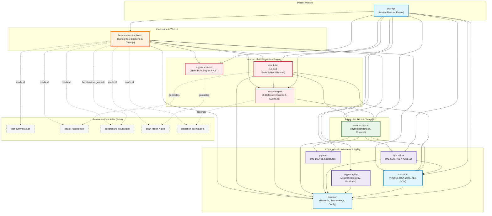

# PQC-APS System Architecture & Module Dependencies

## Module Responsibilities

1. **`pqc-aps`**: Reactor root aggregator managing dependencies (Bouncy Castle 1.80, Spring Boot 3.3.4, JMH 1.37).
2. **`common`**: Protocol data objects (`EncryptedRecord`, `SessionKeys`, `HandshakeConfig`, `DataPaths`).
3. **`classical`**: Classical baseline algorithms: Curve25519 ECDH (`X25519KeyExchange`), PKCS#1 v1.5 (`RsaSignatureScheme`), AES-256-GCM (`AesGcmCipher`).
4. **`crypto-agility`**: Dynamic cryptographic agility registry (`AlgorithmRegistry`, `CryptoSuiteFactory`).
5. **`crypto-scanner`**: Static AST/regex scanning engine with YAML rule registry detecting hardcoded secrets and post-quantum readiness.
6. **`hybrid-kex`**: Hybrid key encapsulation mechanism combining classical X25519 with NIST FIPS 203 ML-KEM-768 (`HybridKeySchedule`, `HybridKeyExchange`).
7. **`pq-auth`**: Post-quantum digital signature scheme implementing NIST FIPS 204 ML-DSA-65 (`MlDsaSignatureScheme`).
8. **`secure-channel`**: Complete 8-step hybrid protocol handshake with mutual key confirmation (`HybridHandshake`, `ClassicalSecureChannel`).
9. **`attack-engine`**: 8 real-time defensive guards (`DowngradeGuard`, `MitmGuard`, `ReplayGuard`, `NonceManager`, `TamperGuard`, `KeyReuseGuard`, `RandomnessGuard`, `TimingGuard`) and persistent `EventLog`.
10. **`attack-lab`**: Active offensive test harness executing the 15-cell evaluation matrix (`SecurityMatrixRunner`, standalone attack tests).
11. **`benchmark-dashboard`**: High-performance visualization dashboard serving live telemetry, benchmark data, and the simulated chat interface (`DashboardDataService`, `ChatDemoService`).
