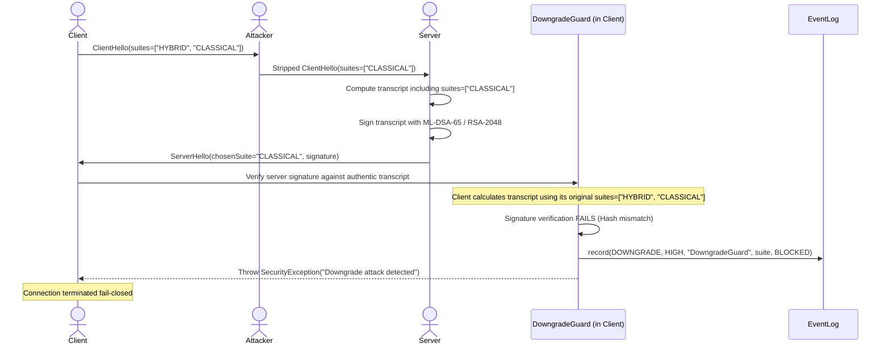
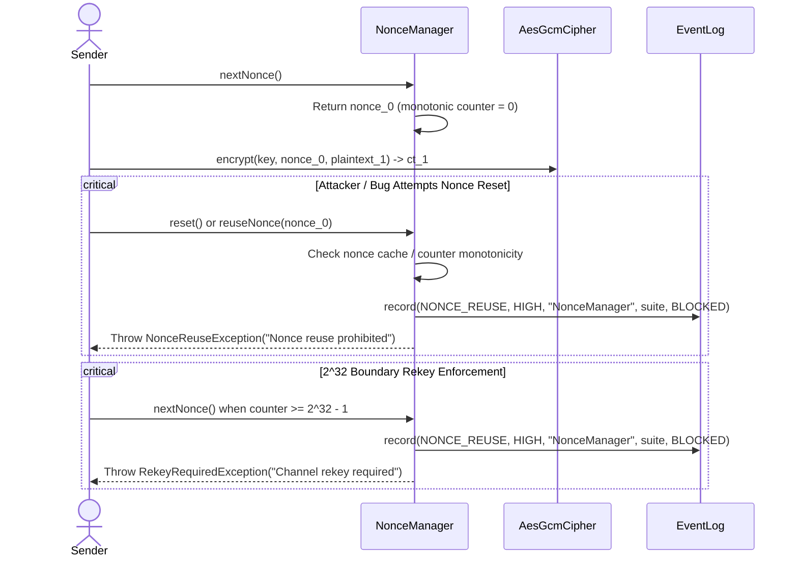
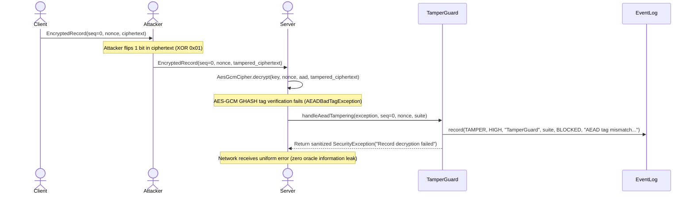

# Attack Execution & Defensive Guard Flows

This document details the exact execution flow of the five primary attacks evaluated in `attack-lab` and demonstrates where the defensive guards in `attack-engine` intercept and neutralize them.

---

## 1. Downgrade Attack vs `DowngradeGuard`



---

## 2. Man-in-the-Middle (MITM) vs `MitmGuard`

```mermaid
sequenceDiagram
    actor Client
    actor Proxy as MITM Proxy (Eve)
    actor Server
    participant Guard as MitmGuard (in Client)
    participant Log as EventLog

    Client->>Proxy: ClientHello
    Proxy->>Server: ClientHello (Leg 1)
    Server->>Proxy: Authentic ServerHello with Server Key
    Proxy->>Proxy: Terminate Server leg; craft rogue ServerHello with Eve's key
    Proxy->>Client: Rogue ServerHello(Eve's Public Key, Eve's Signature)
    Client->>Guard: Validate server public key against pinned identity key
    Note over Guard: Check pinnedServerKey.equals(peerPublicKey)
    Guard->>Guard: Key mismatch! Untrusted key presented
    Guard->>Log: record(MITM, HIGH, "MitmGuard", suite, BLOCKED)
    Guard-->>Client: Throw SecurityException("Pinned key mismatch: rogue server detected")
    Note over Client: Handshake aborted immediately
```

---

## 3. Replay Attack vs `ReplayGuard`

```mermaid
sequenceDiagram
    actor Client
    actor Attacker
    actor Server
    participant Guard as ReplayGuard (in Server)
    participant Log as EventLog

    Client->>Server: EncryptedRecord(seq=0, ciphertext_A)
    Server->>Guard: validateStrictSequence(0, "C2S", suite)
    Guard->>Guard: seq == expectedNextSeq (0 == 0) -> expectedNextSeq = 1
    Server->>Server: Decrypt and process ciphertext_A

    Note over Attacker: Attacker captures EncryptedRecord(seq=0)
    Attacker->>Server: Replay EncryptedRecord(seq=0, ciphertext_A)
    Server->>Guard: validateStrictSequence(0, "C2S", suite)
    Note over Guard: Check: seq (0) < expectedNextSeq (1)
    Guard->>Log: record(REPLAY, HIGH, "ReplayGuard", suite, BLOCKED)
    Guard-->>Server: Throw SecurityException("Replay attack detected: sequence 0 already processed")
    Note over Server: Packet discarded; no duplicate state change
```

---

## 4. GCM Nonce Reuse vs `NonceManager`



---

## 5. Ciphertext & Message Tampering vs `TamperGuard`


