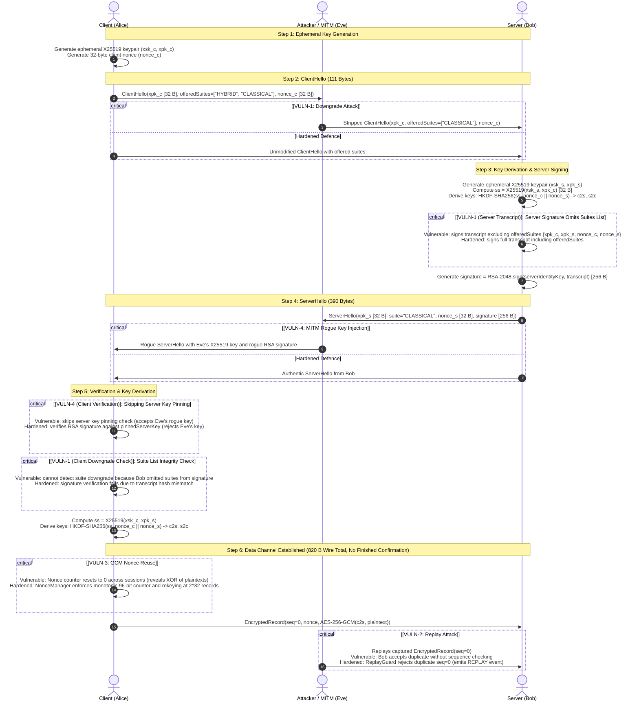

# Classical Baseline Handshake Protocol (`CLASSICAL-VULNERABLE` vs `CLASSICAL-HARDENED`)

Implemented in `com.pqcaps.classical.ClassicalHandshake` (`classical` module). Uses Curve25519 for key exchange, RSA-2048 PKCS#1 v1.5 for signatures, and AES-256-GCM for symmetric transport. Shows the four intentional Phase 1 architectural vulnerabilities (`VULN-1` through `VULN-4`) and their hardened mitigations.

## Summary of Vulnerabilities & Hardening

| Vulnerability ID | Root Cause in `CLASSICAL-VULNERABLE` | Defensive Hardening in `CLASSICAL-HARDENED` & `HYBRID` |
| :--- | :--- | :--- |
| **`VULN-1` (Downgrade)** | `HandshakeConfig.skipSuiteSignature=true`: Server signature covers only key shares and nonces, leaving the offered suite list unauthenticated. | Full handshake transcript including client-offered suites is bound into the digital signature (`DowngradeGuard`). |
| **`VULN-2` (Replay)** | `HandshakeConfig.skipSequenceCheck=true`: Receiving secure channel accepts records without tracking sequence numbers. | `ReplayGuard` maintains strict monotonic sequence validation and a sliding-window replay filter. |
| **`VULN-3` (Nonce Reuse)** | `HandshakeConfig.unsafeNonceMode=true`: 96-bit AES-GCM nonce counter is reset to zero or reuses fixed IVs. | `NonceManager` guarantees strict monotonic increments, forbids IV reuse, and triggers rekeying before counter overflow. |
| **`VULN-4` (MITM)** | `HandshakeConfig.skipKeyPinning=true`: Client accepts any syntactically valid public key without pinning verification. | Strict public key pinning (`MitmGuard`) fails closed if the peer's public key does not match the pinned trust root. |
