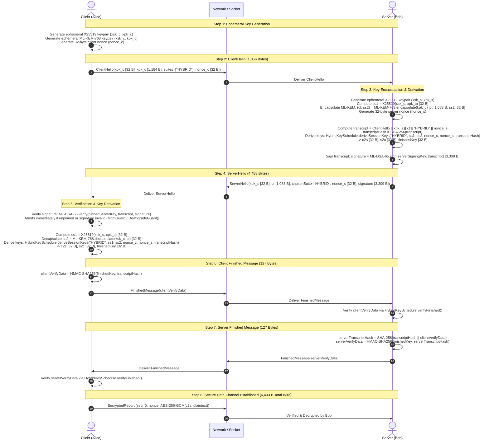

# Post-Quantum Hybrid Handshake Protocol (`HYBRID`)

Implemented in `com.pqcaps.channel.HybridHandshake` (`secure-channel` module). Combines classical Curve25519 Diffie-Hellman with NIST FIPS 203 ML-KEM-768 for quantum-resistant forward secrecy, authenticated by NIST FIPS 204 ML-DSA-65 signatures.

## Verified Code Cross-Check

- **Classes Involved**:
  - `com.pqcaps.channel.HybridHandshake` (`clientHandshake`, `serverHandshake`)
  - `com.pqcaps.classical.X25519KeyExchange` (`generateKeyPair`, `deriveSharedSecret`)
  - `com.pqcaps.kex.MlKemKeyExchange` (`generateKeyPair`, `encapsulate`, `decapsulate`)
  - `com.pqcaps.auth.MlDsaSignatureScheme` (`sign`, `verify`)
  - `com.pqcaps.kex.HybridKeySchedule` (`deriveSessionKeys`, `computeFinished`, `verifyFinished`)
  - `com.pqcaps.channel.FinishedMessage`
- **Wire Overhead**: Total serialized socket bytes = **6,433 B** (1,504 B ClientHello + 4,675 B ServerHello + 127 B Client Finished + 127 B Server Finished). Unframed cryptographic payload = **6,098 B**.
